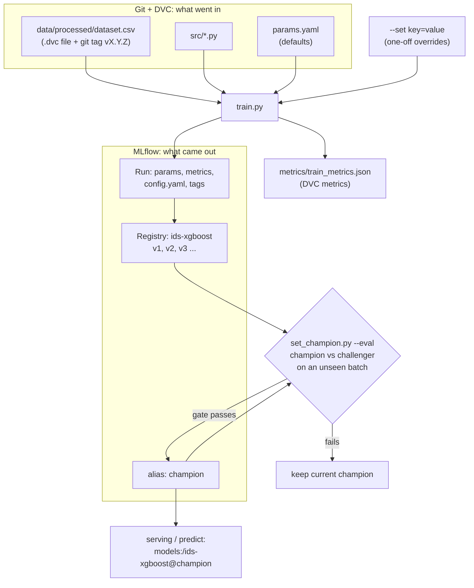

# DVC + MLflow: The Complete Flow (XGBoost)

**Part A** is the commands, in the order to run them. **Part B** explains why each step exists and how DVC and MLflow fit together.

## Which file to follow

| Order | File | When |
|---|---|---|
| 1 | **This file, Part A** | Follow it top to bottom. It is the only file you need to run the pipeline |
| 2 | [`CONFIG_GUIDE.md`](CONFIG_GUIDE.md) | When you want to change a training setting (`params.yaml`, `--set`) |
| 3 | This file, Part B | When you want to know why a step exists |
| - | `WORKFLOW_RETRAIN.md`, `LK06_CHECKLIST.md` | Older notes in Indonesian. You do not need them for the run |

## What is in the repo

| File | Status |
|---|---|
| `params.yaml` (`train:` section) | done. Edit it to change the defaults |
| `src/config.py` | done. Loads `params.yaml` plus `--set` overrides |
| `src/production/train.py` | done. Trains, logs to MLflow, registers, writes `metrics/train_metrics.json` |
| `src/production/ids_model.py` | unchanged (the model wrapper) |
| `src/production/set_champion.py` | done. Moves the `champion` alias, optionally gated by an evaluation |
| `dvc.yaml` (stage `train`) | done |
| `requirements.txt` | already contains `mlflow`, `xgboost`, `scikit-learn`, `pyyaml`, `joblib` (it is UTF-16 encoded, which pip handles). `lightgbm` is listed but not used |

**Tested:** I ran `train.py` twice and every `set_champion.py` mode on a 40,000-row sample, in a scratch MLflow database, and loaded the models back and predicted from raw features. I also confirmed that your existing champion (v1) still loads and predicts. I did **not** run `dvc repro train` or a full-size training on the 1.6M-row dataset.

Conventions: PowerShell from the project root (`MLOps/`) with `.venv` active. Replace `<...>` with your value.

---

# Part A: Commands

## A0. Setup (once per machine)

```powershell
.\.venv\Scripts\Activate.ps1
pip install -r requirements.txt

dvc remote list                 # a remote must exist for pull/push
dvc pull                        # fetch raw + processed data
dvc status                      # expect: "Data and pipelines are up to date."
```

In a second terminal, leave the MLflow UI running (training does not need it, it only reads `mlflow.db`):

```powershell
mlflow ui --backend-store-uri sqlite:///mlflow.db --port 5000       # http://127.0.0.1:5000
```

## A1. Train a model on the current data

Optional first: a quick smoke test that registers nothing.

```powershell
python src/production/train.py --set mlflow.register=false
```

The real run, through DVC so it is recorded in `dvc.lock`:

```powershell
dvc status                                  # the dataset must not be "modified"
dvc repro train                             # trains, logs to MLflow, registers a new model version
git add dvc.lock metrics/train_metrics.json
git commit -m "train: model on data <version tag>"
```

Look at the result: http://127.0.0.1:5000 -> Experiments -> `ids-unsw-nb15` -> the run -> its metrics, `config.yaml` artifact and tags (`data_md5`, `data_git_tag`, `git_commit`). Models -> `ids-xgboost` shows the new version.

The new version does not change production. The `champion` alias still points where it did.

First model ever (empty registry)? Set the first champion by hand:

```powershell
python src/production/set_champion.py <version>      # forced; no argument = newest version
```

## A2. Try other parameters (the 3+ run comparison)

Edit the values yourself. Pick one of three ways:

```powershell
# (a) change the default: edit params.yaml -> train.xgb, then let DVC rerun the stage
dvc repro train

# (b) one-off, MLflow only: no file edited
python src/production/train.py --set xgb.max_depth=10 --set xgb.n_estimators=200 --set mlflow.run_name=xgb-deep
python src/production/train.py --set xgb.max_depth=3  --set xgb.n_estimators=50  --set mlflow.run_name=xgb-shallow

# (c) DVC experiments: DVC edits params.yaml for you and remembers each one
dvc exp run -S train.xgb.max_depth=10 -S train.xgb.n_estimators=200 -n xgb-deep
dvc exp show
```

Any `XGBClassifier` argument can go in `xgb:` (see [`CONFIG_GUIDE.md`](CONFIG_GUIDE.md)). For the course task "at least 3 runs" the default plus two `--set` runs is enough.

## A3. Compare runs and choose the champion

```powershell
# MLflow UI -> Experiments -> ids-unsw-nb15 -> tick the runs -> Compare
# Pick by recall first, then F1 (attacks are the minority class, so ignore accuracy).

python src/production/set_champion.py <version>       # forced move to the version you picked
```

## A4. Retraining loop: new data arrives (example: batch 3)

```powershell
# 1. add the data and record the new data version
python src/simulation/simulate_stream.py --mode list-stream
python src/simulation/simulate_stream.py --mode ingest-batch --batch-id 3 --merge-latest
dvc add data/processed/dataset.csv
git add data/processed/dataset.csv.dvc data/processed/dataset_metrics.json
git commit -m "data ingest: Batch 3"
git tag v1.3.0                                              # next free version number
dvc push
dvc status                                                  # must be clean before training
dvc metrics diff v1.2.2 v1.3.0 --targets data/processed/dataset_metrics.json

# 2. train the challenger on the new data (default configuration)
dvc repro train
git add dvc.lock metrics/train_metrics.json
git commit -m "train: challenger on data v1.3.0"

# 3. dry run: judge champion vs challenger on a batch NEITHER has seen (batch 4); changes nothing
python src/production/set_champion.py --eval data/processed/simulation_stream/batch_4.csv --dry-run
#   the challenger is the newest version; add a version number to pick another one

# 4. the same comparison for real: the alias moves only if the gate passes
python src/production/set_champion.py --eval data/processed/simulation_stream/batch_4.csv
#   exit code 0 = promoted, 1 = gate failed (champion unchanged)
```

Repeat with batch 4 (evaluate on 5), batch 5 (evaluate on 6), and so on. Batch 7 can only be used as an evaluation set. The gate thresholds are in `params.yaml -> train.promote`.

## A5. Use the champion

```powershell
$env:MLFLOW_TRACKING_URI = "sqlite:///mlflow.db"
mlflow models serve -m "models:/ids-xgboost@champion" -p 5001 --env-manager local
```

In Python, with raw features (the same columns the preprocessing produces, without `Label`, `Stime`, `Ltime`):

```python
import mlflow
mlflow.set_tracking_uri("sqlite:///mlflow.db")          # run from the project root
model = mlflow.pyfunc.load_model("models:/ids-xgboost@champion")

float_cols = ["dur", "sbytes", "dbytes", "Sload", "Dload", "Spkts", "Dpkts", "smeansz", "dmeansz"]
df_raw[float_cols] = df_raw[float_cols].astype("float64")     # required: the signature is strict
pred = model.predict(df_raw)                                   # 0 = normal, 1 = attack
```

## A6. Roll back, or reproduce an old model

```powershell
# roll back production: move the alias, no code change
python src/production/set_champion.py <older_version>

# roll back the DATA to an older version (stay on main; take only the data pointer)
git checkout v1.2.0 -- data/processed/dataset.csv.dvc data/processed/dataset_metrics.json
dvc checkout data/processed/dataset.csv.dvc
git add data/processed/dataset.csv.dvc data/processed/dataset_metrics.json
git commit -m "rollback data to v1.2.0"
git tag v1.2.x ; git push origin main --tags               # use a new, unused tag name

# reproduce a past run exactly: its tags hold git_commit and data_md5 (read-only; do not commit here)
git switch --detach <git_commit_from_run_tags>
dvc checkout
python src/production/train.py --set mlflow.register=false
git switch main ; dvc checkout                             # go back
```

Do not use `git checkout <tag>` followed by a commit to roll back data: that leaves you on a detached HEAD, and the commit never reaches `main`.

---

# Part B: Explanation

## B.1 The map



## B.2 Who tracks what

| Question | Answered by |
|---|---|
| Which exact data was used? | **DVC** (`dataset.csv.dvc` md5) + **Git tag** (`v1.3.0`) |
| Which code and parameters? | **Git** commit + `params.yaml` (+ `dvc.lock` for the stage) |
| Can I rebuild this exactly? | **DVC** (`dvc repro`, `dvc checkout`) |
| How did this run score, and with what config? | **MLflow** run (metrics, `config.yaml`, params) |
| Which model is live right now? | **MLflow** registry alias `champion` |
| Which data and commit produced model v3? | **MLflow** run tags `data_md5`, `data_git_tag`, `git_commit` (the bridge between the two tools) |

DVC is the memory of **inputs and pipeline**. MLflow is the memory of **results and models**. Neither replaces the other. They overlap on metrics: DVC's copy (`metrics/train_metrics.json`) is for `dvc metrics diff` and `dvc exp show`; MLflow's copy is for browsing and comparing runs.

## B.3 How the settings are loaded

`train.py` and `set_champion.py` call `load_config()`: it reads `params.yaml -> train` (the defaults), then applies each `--set key=value` on top. The result is used for the data, XGBoost, MLflow and promotion settings and stored in the run as `config.yaml`, so a run can always be reconstructed from what MLflow shows. Details: [`CONFIG_GUIDE.md`](CONFIG_GUIDE.md).

## B.4 The `train` stage in `dvc.yaml`

```yaml
  train:
    cmd: python src/production/train.py
    deps:
      - src/production/train.py
      - src/production/ids_model.py
      - src/config.py
      - data/processed/dataset.csv
    params:
      - train.data
      - train.xgb
    metrics:
      - metrics/train_metrics.json:
          cache: false
```

- **`deps`**: if the code or the dataset changes, `dvc repro train` runs again. If nothing changed, it prints "Stage 'train' didn't change, skipping" and no new MLflow run is created. Force a run with `dvc repro -f train`.
- **`params`**: only `train.data` and `train.xgb` count. Editing `train.mlflow` or `train.promote` does not retrigger training.
- **`metrics`**: `cache: false` keeps the small JSON in Git (same as the `split` stage's metrics), so `dvc metrics diff` works across commits.
- **No `outs`**: the model is not a DVC output. It lives in MLflow (`mlflow.db` + `mlruns/`, both git-ignored).
- `dataset.csv` is produced by `dvc add` (not by a stage), and DVC accepts such a file as a dependency. `dvc repro` will not rebuild it. New data enters through the commands in A4.
- The stage runs `train.py` with no arguments, so it always uses the `params.yaml` defaults and registers a model version.

## B.5 Step by step: why

**A0 Setup.** `dvc pull` brings in the data that Git does not hold. The UI process only reads `mlflow.db`; training does not need it running.

**A1 First model.** `dvc repro train` rather than a plain `python ...` call gives you a `dvc.lock` entry, which pins the exact hashes of the code, data and params used. Commit it so the Git history tells the same story as the MLflow run list. The smoke run with `register=false` checks that everything works without adding a registry version.

**A2 Other parameters.** The three ways differ in where the bookkeeping lives:

| | (a) edit `params.yaml` | (b) `--set` | (c) `dvc exp run -S` |
|---|---|---|---|
| Recorded in MLflow | yes | yes | yes |
| Recorded by DVC | yes (`dvc.lock`, `dvc params diff`) | no | yes (`dvc exp show`) |
| Touches `params.yaml` | yes | no | yes, in your working tree (revert with `git checkout params.yaml`) |
| Best for | a new default | quick tuning, the "3 runs" | experiments you may want to keep |

Each run registers a new model version (unless `mlflow.register=false`). That is fine for a handful of runs, because the **alias**, not the version number, decides what production loads.

**A3 Pick the champion.** The UI compare view shows parameters next to metrics. For an IDS the deciding metric is recall on the attack class (a missed attack costs more than a false alarm), with F1 as a sanity check. `set_champion.py` without `--eval` is a forced move with no evaluation, and with no argument it picks the *newest* version, not the best, so name the version explicitly after comparing.

**A4 Retraining loop.** Each part has a purpose:

1. *Ingest + `dvc add` + tag + `dvc push`*: a new dataset version is created and uploaded before anything is trained on it, so the training run can point at an immutable hash. The `dvc status` check guards against training on a file that no longer matches its recorded version.
2. *`dvc repro train`*: the challenger is trained with the default configuration on `dataset.csv`. It becomes a new registry version, but the `champion` alias still points to the old one, so production is unaffected.
3. *Compare on a future batch*: see B.7.
4. *`--eval` without `--dry-run`*: moves the alias only when the gate in `params.yaml -> train.promote` passes. Otherwise the champion stays and the challenger remains in the registry for inspection.

**A5 Using the champion.** Callers use `models:/ids-xgboost@champion`. The model is an `IDSModel` pyfunc that carries its own frequency-encoding maps, so callers send **raw** features (with `proto`, `state`, `service` as strings). The signature is strict (see B.9).

**A6 Rollback and reproduction.** Moving the alias is the production rollback. Reproduction works because every run carries `git_commit` and `data_md5`: check out that commit, `dvc checkout` restores the data, and `train.py` retrains with the same code, params and data.

## B.6 The traceability chain

```text
alias champion -> model version N -> MLflow run
   run tags: git_commit, data_md5, data_git_tag, set_overrides
   run artifact: config.yaml (final config)
        |                 |
        v                 v
   git commit        dataset.csv.dvc (md5) -> DVC cache / remote
   (code, params.yaml, dvc.lock)
```

Start from the live model and you can reach the exact code, parameters and data. `data_git_tag` is the newest git tag whose `dataset.csv.dvc` has the same md5 as the data used (for example `v1.2.2` after a rollback to the `v1.2.0` data).

## B.7 Why the comparison uses a future batch

`train.py` reports metrics on a random 20% test split of `dataset.csv`. When the dataset grows, the new model's test rows can include rows the old model already trained on, and the two models are scored on different questions, so those numbers cannot decide a promotion.

The batches are time-ordered, so the next unseen one is a natural fair test:

```text
train challenger on:  base + batch 1,2,3     (dataset v1.3.0)
champion trained on:  base + batch 1,2
evaluate BOTH on:     batch 4                <- seen by neither
```

This also matches production: a model is always judged on traffic that arrived after it was trained.

## B.8 `set_champion.py`: one script, two modes

| Command | What it does | Use it for |
|---|---|---|
| `set_champion.py [version]` | Moves the alias to `version` (default: newest). **No evaluation** | First champion, rollback, manual override |
| `set_champion.py --eval <csv> [version] --dry-run` | Scores champion and challenger on `<csv>`, prints the table and the verdict, **changes nothing** | Looking before you decide |
| `set_champion.py --eval <csv> [version]` | Same comparison; moves the alias to the challenger only if the gate passes, and records `eval_*` metrics and a `promoted` tag on the challenger's run | The normal promotion step |

In `--eval` mode `version` is the challenger (default: newest). The gate (`params.yaml -> train.promote`): the challenger's `metric` (recall) must beat the champion's by at least `min_gain`, and the `guard_metric` (F1) must not drop by more than `max_guard_drop`. Exit code `0` = passed, `1` = failed, so a script can chain on the result.

## B.9 Pitfalls

1. **`dvc repro` skips unchanged stages**, so no new MLflow run appears. Use `dvc repro -f train` to force one.
2. **`dvc exp run` edits `params.yaml`** in your working tree. Look at `git diff params.yaml` before committing.
3. **`--set` runs are invisible to DVC.** They are tracked only in MLflow. If a variation becomes the new default, copy its values into `params.yaml` and commit.
4. **Never train on a modified dataset** (`dvc status` not clean), or `data_md5` will not match the data actually used.
5. **The signature is strict.** MLflow rejects `int64` for a `double` column and `float64` for a `long` column. `train.py` and `set_champion.py` cast the columns in `data.float_columns` to `float64` for you. Your own prediction code must do the same (see A5), or `predict` fails with "Failed to enforce schema".
6. **Category vocabulary.** UNSW `state` values (`FIN`, `INT`...) differ from Zeek `conn_state` values (`SF`, `S0`...). Live Zeek rows will mostly encode to 0 for `state`. The mechanics here work, but expect weaker accuracy on live traffic until this is aligned.
7. **Imbalance.** The attack rate varies per batch (about 20 to 27% in the early ones). Judge on recall and F1, not accuracy.
8. **Git-ignored state.** `mlflow.db`, `mlruns/`, `mlartifacts/` and `artifacts/` are not in Git. Back them up, or use a shared tracking server (`mlflow.tracking_uri` in `params.yaml`) if more than one person trains.
9. **Old versions keep their old code.** Each registered version carries its own copy of `ids_model.py` (`code_paths`), so v1 still loads after you change the file. Only new versions get the new code.
10. **Registry growth.** `dvc repro train` and `train.py` register a version every time they actually train. Use `--set mlflow.register=false` for throw-away runs (direct call only; the DVC stage always uses the defaults).
11. **Same `ids_model.py` for both models in `--eval`.** `set_champion.py --eval` loads two model versions in one process. This works while they share the same wrapper code. If you change `ids_model.py` in a way that is incompatible with an old version, evaluate that old version in its own process.
12. **Detached HEAD.** After `git checkout <tag>` or `git switch --detach`, do not commit. Switch back to `main` first.
