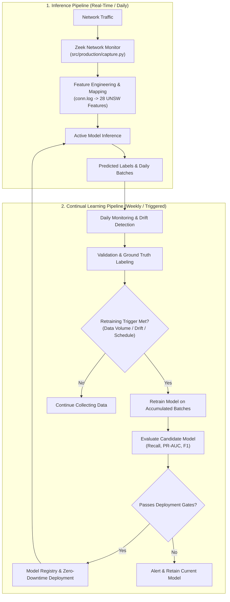

# 🛡️ Adaptive Network Intrusion Detection System (Adaptive NIDS) with Continual Model Retraining

> **MLOps Project**: Intrusion Detection System (IDS) Jaringan Adaptif dengan Menggunakan Pendekatan *Continual Model Retraining*.

---

## 📌 Project Overview

Digital infrastructure across public services, banking, government, and enterprise faces rapidly growing cyber threats such as network intrusions, malware, botnets, and DDoS attacks. According to the **National Cyber and Crypto Agency (BSSN) Indonesia (2024)**, over **330.5 million traffic anomalies** were monitored, with the **Mirai Botnet** representing the largest single anomaly category (~81.3 million activities).

Traditional machine learning and deep learning-based Network Intrusion Detection Systems (NIDS) are trained on static historical data. However, **network traffic characteristics and attack patterns evolve continuously**, leading to severe model degradation and concept drift over time.

### 💡 Proposed Solution
This project develops an **Adaptive AI-driven NIDS** integrated with an end-to-end **MLOps Continual Retraining Pipeline**:
- **Real-Time Data Capture**: Captures live network traffic at the session/application layer using **Zeek** ([`src/production/capture.py`](file:///home/alex/Documents/mlops/MLOps-AdaptiveNIDS/src/production/capture.py)).
- **Continual Retraining Simulation**: Partitioning the **UNSW-NB15** benchmark dataset into sequential batches to simulate incoming data streams over time ([`src/simulation/simulate_stream.py`](file:///home/alex/Documents/mlops/MLOps-AdaptiveNIDS/src/simulation/simulate_stream.py)).
- **Automated Drift & Trigger Mechanism**: Monitors data distribution shifts and performance metrics. Retraining is triggered automatically upon reaching threshold drift levels or scheduled intervals.

---

## 📊 Dataset: UNSW-NB15

The model is trained and evaluated on the **UNSW-NB15** dataset, created by IXIA PerfectStorm at the Cyber Range Lab of the Australian Centre for Cyber Security (ACCS):
- **Total Records**: 2,540,044 network flow instances across 4 CSV files.
- **Features**: 49 raw attributes (packet-level, flow-level, and connection-level statistics).
- **Preprocessed Schema**: 28 features mapped to Zeek `conn.log` equivalents.
- **Attack Categories**: Contains 9 modern attack families (*Fuzzers, Analysis, Backdoors, DoS, Exploits, Generic, Reconnaissance, Shellcode, Worms*).
- **Classification Objective**: Binary classification (`Normal` vs. `Attack`), prioritizing high recall for attack detection.

---

## 🏗️ System Architecture & Pipelines

The system links real-time traffic monitoring via Zeek with an offline/continual retraining loop:



### 🎯 Key Evaluation Metrics

| Category | Metric | Objective |
| :--- | :--- | :--- |
| **Model Performance** | **Recall (Primary)** | Prioritize detecting true attacks and minimize false negatives. |
| | **F1-Score** | Balance precision and recall. |
| | **PR-AUC** | Robust evaluation for heavily imbalanced anomaly distributions. |
| **System Performance** | **Inference Latency** | Time taken to predict per batch/flow. |
| | **Throughput** | Number of network flows analyzed per second. |
| | **Retraining Duration** | Time required to retrain and validate candidate models. |
| **Continual Learning** | **Metric Delta ($\Delta$)** | Measure stability and adaptation of Recall, F1, and PR-AUC before vs. after retraining. |

---

## 📡 Live Traffic Capture & Production Pipeline

The production pipeline in [`src/production/`](file:///home/alex/Documents/mlops/MLOps-AdaptiveNIDS/src/production/) manages live packet capture, raw log ingestion, and preprocessing. Datasets are versioned with **DVC + Git tags**.

### 1. List Available Network Interfaces
```bash
python3 src/production/capture.py -l
```

### 2. Capture Live Network Packets with Zeek
```bash
# Capture live traffic on interface wlo1 for 60 seconds (requires root/sudo)
sudo python3 src/production/capture.py -i wlo1 -d 60
```
> Output logs are saved in sequentially numbered directories under `zeek_logs/run_1/`, `zeek_logs/run_2/`, etc.

### 3. Ingest Raw Zeek Logs (`data/raw/zeek/`)
```bash
python3 src/production/ingest_data.py --zeek-log zeek_logs/run_1/conn.log --no-preprocess
```

### 4. Preprocess Features (`data/processed/dataset.csv`)
```bash
python3 src/production/preprocess_data.py --raw-file data/raw/zeek/raw_zeek_run_1_conn.csv
```

For detailed step-by-step production documentation, see [`src/production/README.md`](file:///home/alex/Documents/mlops/MLOps-AdaptiveNIDS/src/production/README.md).

---

## 🚀 Active Inference Model (MLflow Model Registry)

| Item | Value |
| :--- | :--- |
| Registered model | `adaptive-nids-xgb` |
| **Production version** | **v1**: `models:/adaptive-nids-xgb/Production` (alias `@champion`) |
| Trained on | dataset `v1.1.0` (base + batch 1), md5 `21be6cc162573182b8ae89df7f65278b` |
| XGBoost params | `n_estimators=100, max_depth=6, learning_rate=0.3` |
| Hold-out (batch 7, never trained on) | recall `0.9736`, F1 `0.9775`, precision `0.9815` |
| Reference files | [`models/production_model.yaml`](models/production_model.yaml), [`models/production.dvc`](models/production.dvc) (DVC) |

**Why this version.** v1 is the champion of the continual-retraining loop: every model retrained on more data
(data v1.2.2–v1.6.0) was evaluated against it on the next unseen batch, and none reached the promotion gate
(+0.002 recall, F1 drop ≤ 0.01); they all had 0.13–0.24 pp lower recall. v2 kept the same data (v1.1.0) and only
tuned XGBoost (n_estimators 100→200, max_depth 6→8, learning_rate 0.3→0.1). On the hold-out batch 7 it had slightly
higher F1 (0.9777 vs 0.9775) and precision (0.9822 vs 0.9815), but lower recall (0.9733 vs 0.9736), so it failed the
gate and was archived. For an IDS a missed attack costs more than a false alarm, so recall decides.

**Version history**

| Version | Source | Stage | Note |
| :--- | :--- | :--- | :--- |
| v1 | champion of `ids-xgboost` (v1, data v1.1.0), `n_estimators=100, max_depth=6, learning_rate=0.3` | **Production** (`@champion`) | highest recall on unseen data |
| v2 | same data, `n_estimators=200, max_depth=8, learning_rate=0.1` | Archived | failed the gate (recall −0.0003) |

**Load it**

```python
import mlflow
mlflow.set_tracking_uri("sqlite:///mlflow.db")
model = mlflow.pyfunc.load_model("models:/adaptive-nids-xgb/Production")
pred = model.predict(df_raw)   # raw UNSW-mapped features; float columns as float64
```

**Verify it:** `python src/production/verify_inference.py` loads the Production model, scores batch 7, measures
latency/throughput, and checks that the stage, the `@champion` alias and the DVC copy serve the same model (`READY`).

**Change or roll back:** `python src/production/transition_stage.py <version> Production --archive-existing`,
then `python src/production/export_model_metadata.py` + `dvc add models/production` and commit.

---

## 🚀 Setup & Installation Guide

### Prerequisites
- **Python 3.11+**
- **Zeek Network Security Monitor**
- **Git**

---

### 📦 Installing Zeek Network Security Monitor

Zeek is required for live network packet capture and session log generation.

#### 🐧 Ubuntu / Debian
```bash
# Option 1: Standard Repository
sudo apt update
sudo apt install -y zeek

# Option 2: Official Binary Repository (Recommended for Ubuntu 22.04 LTS)
echo 'deb http://download.opensuse.org/repositories/security:/zeek/xUbuntu_22.04/ /' | sudo tee /etc/apt/sources.list.d/security:zeek.list
curl -fsSL https://download.opensuse.org/repositories/security:/zeek/xUbuntu_22.04/Release.key | gpg --dearmor | sudo tee /etc/apt/trusted.gpg.d/security_zeek.gpg > /dev/null
sudo apt update
sudo apt install -y zeek
```

#### 🍎 macOS (Homebrew)
```bash
brew install zeek
```

#### 🎩 Fedora / RHEL / CentOS
```bash
sudo dnf install -y zeek
```

#### 🔒 Granting Non-Root Packet Capture Capabilities
To allow Zeek to capture raw network traffic without requiring `sudo` on every run:
```bash
sudo setcap cap_net_raw,cap_net_admin=eip $(which zeek || echo /opt/zeek/bin/zeek)
```

#### 🛠️ Verifying Zeek Installation
```bash
zeek --version
```
*(Example output: `zeek version 6.0.0`)*

---

### 🐍 Python Environment Setup

1. **Clone the Repository**:
   ```bash
   git clone https://github.com/xx-bot/MLOps-AdaptiveNIDS.git
   cd MLOps-AdaptiveNIDS
   ```

2. **Create and Activate Virtual Environment**:
   ```bash
   python3 -m venv .venv
   source .venv/bin/activate
   ```

3. **Install Dependencies**:
   ```bash
   pip install --upgrade pip
   pip install -r requirements.txt
   ```

4. **Launch Jupyter Lab**:
   ```bash
   jupyter lab
   ```

---

## 💻 GitHub Codespaces Setup

1. Navigate to [`xx-bot/MLOps-AdaptiveNIDS`](https://github.com/xx-bot/MLOps-AdaptiveNIDS).
2. Click **`<> Code`** > **`Codespaces`** > **`Create codespace on main`**.
3. Select a machine with at least **4 cores / 16 GB RAM** for processing raw CSV datasets.

---

## 💾 Dataset Management

Place raw **UNSW-NB15** dataset files inside `data/raw/`:

```text
data/
├── raw/
│   ├── NUSW-NB15_features.csv
│   ├── UNSW-NB15_1.csv through 4.csv
│   └── zeek/                        # Raw ingested Zeek CSV logs
└── processed/                       # Preprocessed & versioned dataset catalog
```

---

## 📁 Repository Structure

```text
MLOps-AdaptiveNIDS/
├── .devcontainer/
│   └── devcontainer.json             # Codespaces container configuration
├── data/
│   ├── raw/                          # Raw UNSW-NB15 dataset & raw Zeek logs (data/raw/zeek)
│   └── processed/                    # DVC-tracked datasets (versions v1.0.0, v1.1.0... = Git tags)
├── models/
│   ├── production.dvc                # DVC pointer to the exported Production model (models/production/)
│   └── production_model.yaml         # Production model metadata: version, run_id, metrics, data lineage
├── notebook/
│   ├── EDA.ipynb                     # Exploratory Data Analysis
│   └── preprocessing.ipynb           # Feature engineering & UNSW-NB15 schema mapping
├── src/
│   ├── production/                   # Production capture, raw ingestion, & preprocessing
│   │   ├── capture.py                # Live packet capture via Zeek engine
│   │   ├── ingest_data.py            # Ingests conn.log into data/raw/zeek
│   │   ├── preprocess_data.py        # Maps schema & writes data/processed/dataset.csv
│   │   ├── train.py                  # Trains XGBoost, logs & registers it in MLflow
│   │   ├── ids_model.py              # MLflow pyfunc wrapper (model + encoding maps)
│   │   ├── set_champion.py           # Moves the `champion` model alias (optionally gated)
│   │   ├── transition_stage.py       # Moves a model version None -> Staging -> Production (-> Archived), syncs aliases
│   │   ├── export_model_metadata.py  # Exports the Production model + production_model.yaml for DVC
│   │   ├── verify_inference.py       # Loads models:/adaptive-nids-xgb/Production and checks predictions
│   │   └── README.md                 # Production step-by-step documentation
│   ├── simulation/                   # Historical data streaming & simulation
│   │   ├── preprocess.py             # Offline UNSW-NB15 dataset cleaner
│   │   └── simulate_stream.py        # Stream batch partitioner
│   ├── config.py                     # Loads params.yaml -> train (+ --set overrides)
│   ├── dataset_io.py                 # Writes dataset.csv + dataset_metrics.json
│   └── README.md                     # CLI scripts overview & detailed reference
├── dvc.yaml                          # DVC pipeline stages (preprocess, split, train)
├── params.yaml                       # Parameters: split (train_ratio, num_batches) and train (data, XGBoost, MLflow, promotion gate)
├── docker-compose.yml                # SeaweedFS S3 server used as the DVC remote
├── .env.example                      # S3 credentials template (copy to .env)
├── PIPELINE_FLOW.md                  # START HERE: DVC + MLflow commands, in order, and why
├── CONFIG_GUIDE.md                   # Training settings reference (params.yaml, --set)
├── DVC_MIGRATION.md                  # How data versioning moved to DVC
├── zeek_logs/                        # Captured Zeek session logs (run_1, run_2...)
├── zeek_unsw_mapping.json            # JSON schema mapping Zeek conn.log to UNSW-NB15
├── zeek_unsw_feature_mapping.md      # Detailed Zeek to UNSW feature mapping guide
├── preprocessing_summary.txt         # Preprocessing steps summary
├── pipeline_architecture.md          # Preprocessing pipeline diagram (Mermaid)
├── requirements.txt                  # Python dependencies
├── LICENSE                           # Project license
└── README.md                         # Main project documentation
```

---

## 👥 Contributors & Acknowledgements

- **Author**: Alexander Angelo ([@xx-bot](https://github.com/xx-bot))
- **Course**: MLOps (Semester 5)
- **Supervisor**: Rizal Setya Perdana, S.Kom., M.Kom., Ph.D.
