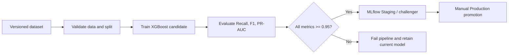

# Adaptive Network Intrusion Detection System

An MLOps project for detecting network attacks with XGBoost and simulating continual
retraining on UNSW-NB15 traffic. Zeek supplies live connection logs, DVC versions
datasets and exported models, and MLflow records experiments and model versions.

## What is implemented

- Offline UNSW-NB15 preprocessing and chronological stream batches.
- Live Zeek capture, ingestion, and mapping into the training feature schema.
- Reproducible training and validation with Recall, F1, and PR-AUC gates.
- GitHub Actions unit tests and a training pipeline that registers passing
  candidates in Staging with the `challenger` alias.
- Manual Production promotion, model export, and inference verification.

Scheduled retraining, drift detection, and ground-truth labeling remain planned
extensions. Automatically assigned labels on live logs require human verification
before those records can support model evaluation.

## Quick start

Use Python 3.11 and run commands from the repository root:

```bash
python3 -m venv .venv
source .venv/bin/activate
python -m pip install -r requirements-test.txt
python -m pytest -q --junitxml=reports/pytest.xml
```

Unit tests use small fixtures and mocks; they run without the full datasets, Docker,
Zeek, or a running MLflow service. See [testing details](tests/README.md).

For training and registry operations, install `requirements-automation.txt` instead.
`requirements.txt` contains the full pinned environment for exploration and
notebooks; the smaller profiles use its versions as constraints.

## Pipeline



The automatic gate reserves 20% of flow groups from `dataset.csv` for validation,
using seed 42. Duplicate flows stay together in one partition. Batch 7 remains
reserved for final testing and is excluded from the automatic gate.

Pushes and pull requests targeting `main` run tests on GitHub-hosted runners.
Successful pushes to `main`, or manual runs on `main`, continue on a self-hosted
runner with access to the DVC remote and persistent MLflow storage.

## Repository layout

| Path | Purpose |
|---|---|
| `src/production/` | Capture, ingestion, preprocessing, training, evaluation, and registry CLIs. |
| `src/simulation/` | Offline cleaning and historical stream simulation. |
| `src/config.py`, `src/dataset_io.py` | Shared configuration and dataset storage helpers. |
| `tests/` | Pytest suite and detailed testing notes. |
| `notebook/` | Exploratory analysis and preprocessing experiments. |
| `data/` | Raw and processed datasets; large files are managed by DVC. |
| `models/` | Exported Production model pointer and metadata. |
| `metrics/` | Training metrics tracked by Git. |
| `zeek_logs/example/` | Sample capture logs for ingestion examples. |
| `docs/` | Operations guide. |
| `.github/workflows/` | Automated testing and training workflow. |

Training settings live in [params.yaml](params.yaml), pipeline stages in
[dvc.yaml](dvc.yaml), and local S3 storage in
[docker-compose.yml](docker-compose.yml). Local datasets, captures, reports,
credentials, and MLflow storage are excluded from Git.

## Documentation

- [Operations guide](docs/operations.md): setup, DVC, simulation, live capture,
  configuration, Actions runner setup, and model registry commands.
- [Testing guide](tests/README.md): test coverage and local execution.

The recorded Production model is `adaptive-nids-xgb` v1 (`champion`), trained on
dataset `v1.1.0`. Its exported identity and lineage are recorded in
[models/production_model.yaml](models/production_model.yaml); see the
[registry reference](docs/operations.md#model-registry-and-inference) for usage
and historical evaluation results.

## Project information

Author: Alexander Angelo ([@xx-bot](https://github.com/xx-bot)).
Course: MLOps, Semester 5. Supervisor: Rizal Setya Perdana, S.Kom., M.Kom., Ph.D.
Licensed under the [MIT License](LICENSE).
